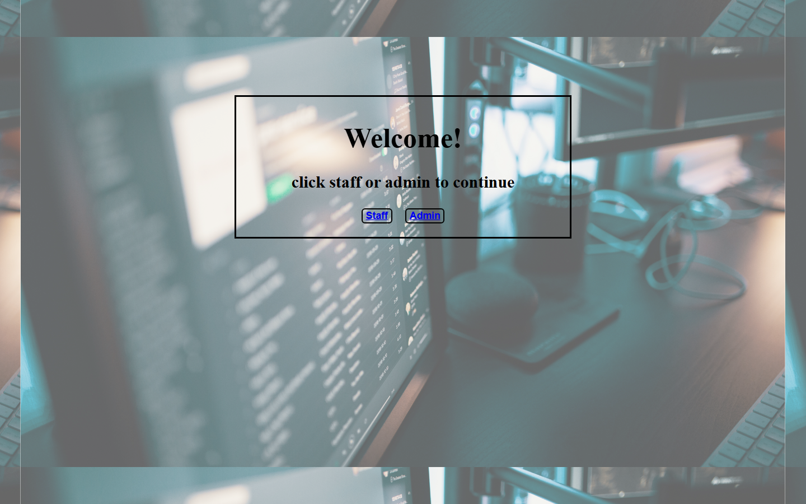
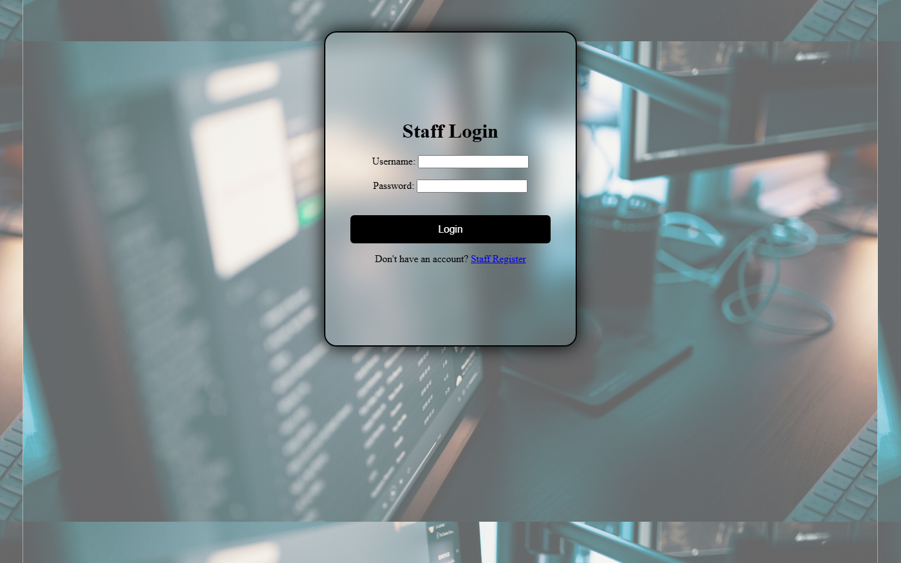
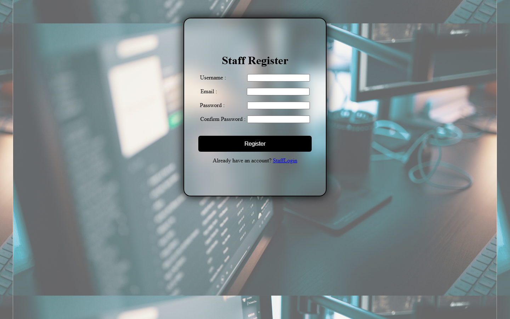
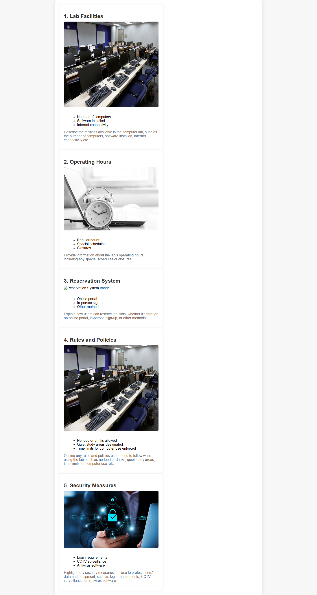
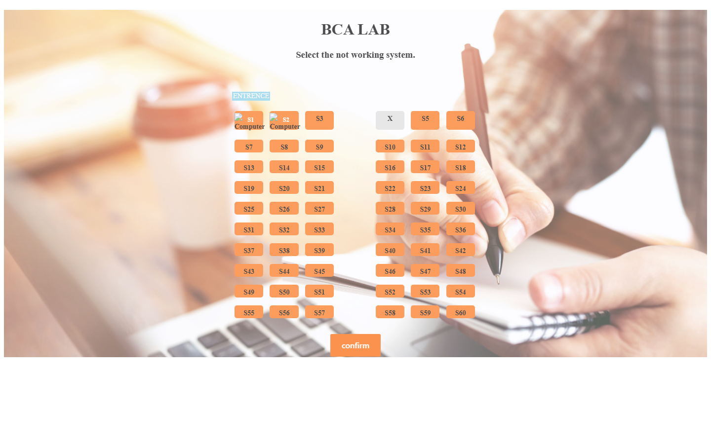
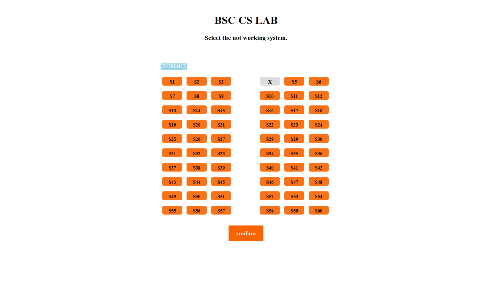
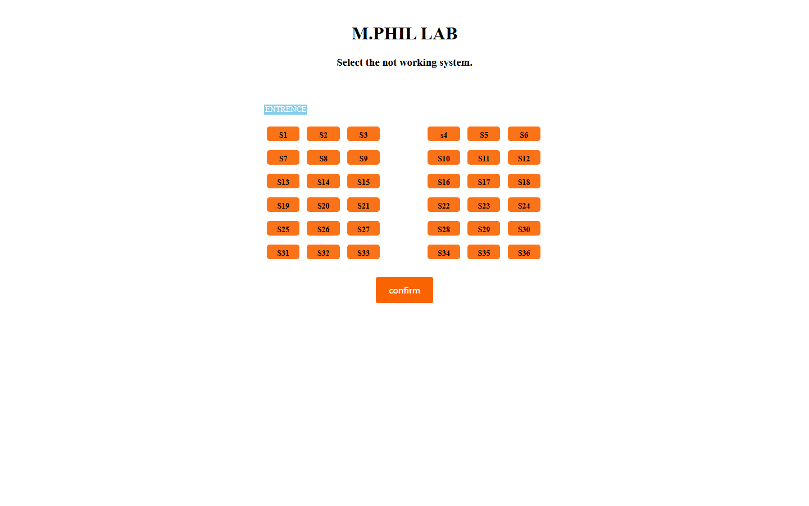
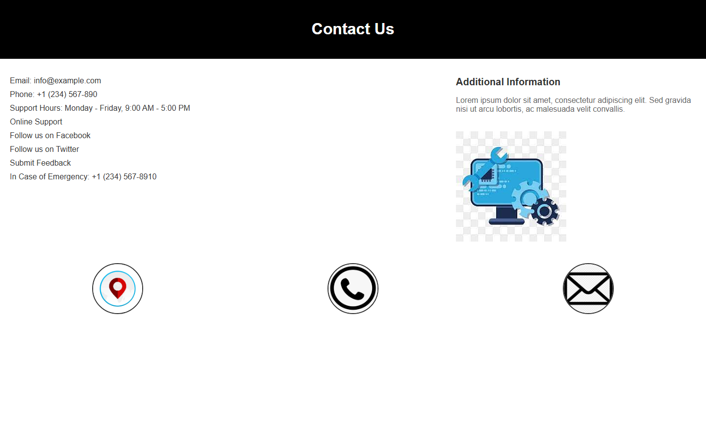
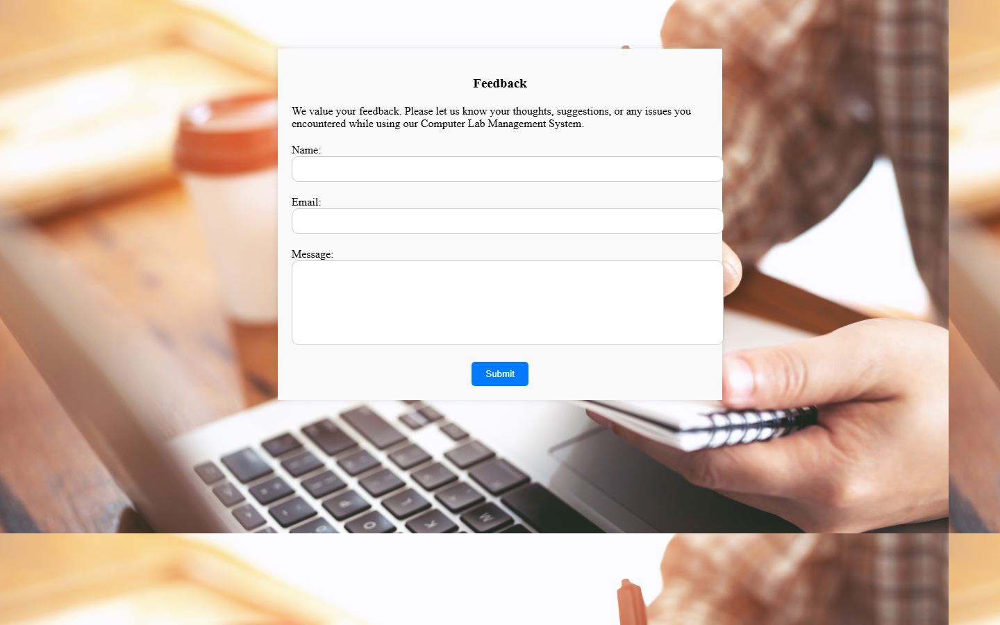

# Computer Lab Management System (CLMS)

A web-based Computer Lab Management System developed as my UG Final Year Project (2024).

## Technologies Used
- Python
- Django
- HTML
- CSS
- JavaScript
- MySQL
- Django Templates

## Main Features
- Student Login
- Student Registration
- Admin Login
- Admin Registration
- Home Page
- Course / Department Details
- BCA Seat Information
- BSc Seat Information
- MSc IT Seat Information
- M.Phil Information
- Contact Page
- Feedback Page

## Screenshots

### Home Page

### Staff Login

### Staff Registration

### Details

### BCA Seats

### BSc Seats

### MSc IT Seats

### M.Phil

### Contact

### Feedback

## How to Run

### 1. Create a virtual environment
python -m venv venv

### 2. Activate the virtual environment
.\venv\Scripts\Activate.ps1

### 3. Install dependencies
pip install -r requirements.txt

### 4. Run migrations
python manage.py migrate

### 5. Start the Django server
python manage.py runserver

Open: http://127.0.0.1:8000/

## Project Information

**Project:** Computer Lab Management System (CLMS)
**Type:** UG Final Year Project
**Year:** 2024
**Framework:** Django
**Language:** Python

Developed as part of my undergraduate academic project in 2024.

## Project Team

This UG Final Year Project was developed collaboratively by:

- Devarajan J.
- J Ram Dinesh
- S Renold Akash

We worked together on the design, development, testing, and documentation of the College Learning Management System.
